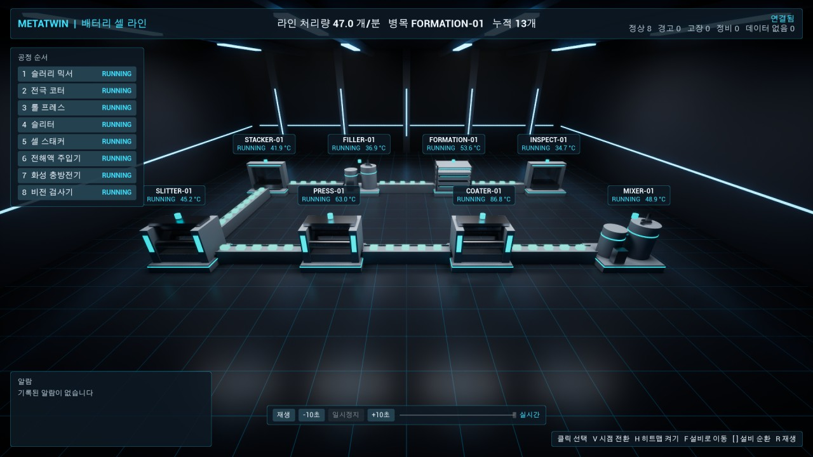
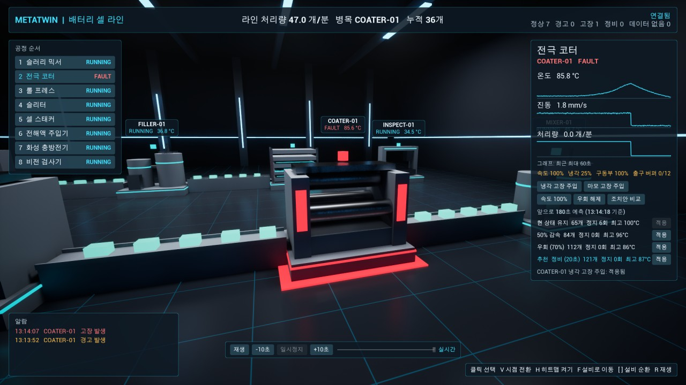
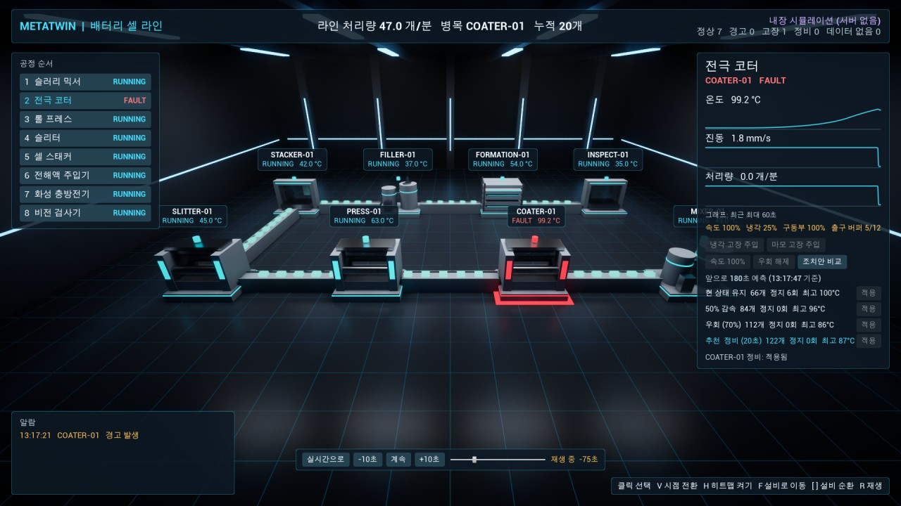
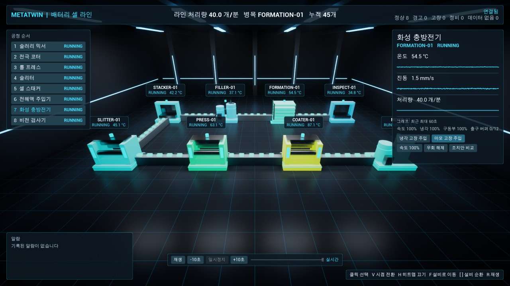
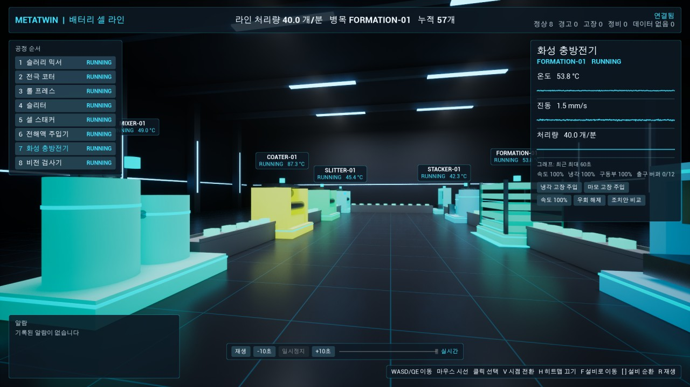

# MetaTwin

배터리 셀 공장의 디지털 트윈 데모. 설비 데이터를 실시간으로 3D에 동기화하고, 고장을 진단하고, 조치안을 예측해 비교한다.
Unreal Engine 5.8 / C++ / UMG / WebSocket / Unreal MCP



소개 영상(100초): [Docs/media/MetaTwin.mp4](Docs/media/MetaTwin.mp4)

## 무엇을 보여주는가

| | |
|---|---|
|  고장 시점에서 조치안 4가지를 180초 앞까지 예측해 비교한다 |  최근 10분을 되감으면 3D와 HUD가 그 시점을 보여준다 |
|  오래된 데이터는 히트맵에 칠하지 않는다 |  드론 시점으로 라인을 살펴본다 |

- **통신 신뢰성:** 중복·역순·이전 세션 데이터를 버리고, 끊김과 무응답을 감지해 지수 백오프로 재연결한다. 끊긴 값은 정상처럼 보이지 않게 STALE로 표시한다.
- **명령 안전:** 응답(ack)을 확인하고, 응답이 없는 명령은 중복 실행을 막기 위해 다시 보내지 않는다. 재생 중에는 조작을 막는다.
- **시뮬레이션 검증:** Python 에뮬레이터와 C++ 공정 모델이 같은 수식을 쓰는지 기준 데이터로 검사한다.
- **데이터 기반 구성:** `Content/Data/plant_layout.json` 하나로 에뮬레이터, 공정 모델, 레벨 배치를 만든다. 레벨은 Unreal MCP 스크립트로 다시 만들 수 있다.

구조와 설계 결정은 [Docs/DESIGN.md](Docs/DESIGN.md)에 있다.

## 핵심 코드

| 파일 | 볼 내용 |
|---|---|
| [TelemetrySubsystem.cpp](Source/MetaTwin/TelemetrySubsystem.cpp) | 연결과 재연결, 명령 응답 확인, 재생 시점, 내장 시뮬레이션 전환 |
| [TwinRegistry.cpp](Source/MetaTwin/TwinRegistry.cpp) | 세션과 순번으로 중복·역순 데이터를 거르고 신선도를 판정 |
| [TwinTelemetry.cpp](Source/MetaTwin/TwinTelemetry.cpp) | 수신 JSON 검증, 명령 생성, 재연결 간격 |
| [TwinPlant.cpp](Source/MetaTwin/TwinPlant.cpp) | 공정 모델, 조치안 예측(What-if), 타임라인 기록 |
| [TwinLine.cpp](Source/MetaTwin/TwinLine.cpp) | 라인 요약과 병목, 알람 판정 |
| [TwinMachineActor.cpp](Source/MetaTwin/TwinMachineActor.cpp) | 설비의 3D 표시와 애니메이션, 히트맵 |
| [TwinHudWidget.cpp](Source/MetaTwin/TwinHudWidget.cpp) | 관제 HUD(UMG) |
| [Tests](Source/MetaTwin/Tests) | 자동화 테스트 12개 |
| [plant.py](Tools/emulator/plant.py), [emulator.py](Tools/emulator/emulator.py) | Python 설비 에뮬레이터 |
| [build_factory_level.py](Tools/build_factory_level.py) | Unreal MCP로 레벨을 구성하는 스크립트 |

## 실행

**패키지:** [MetaTwin-Win64.zip](https://github.com/jaceman7/MetaTwin/releases/latest/download/MetaTwin-Win64.zip)(Windows, 316MB)을 풀고 `MetaTwin.exe`를 실행한다. 서버가 없으면 6초 뒤 내장 시뮬레이션으로 전체 흐름을 진행할 수 있다.

**서버 연결:** 먼저 `python Tools/emulator/emulator.py`를 실행한다(Python 3, 추가 패키지 없음). `--chaos`는 중복·지연 프레임을 섞는다.

**소스에서 열기:** Unreal Engine 5.8, Visual Studio 2022(C++ 게임 개발), Git, Git LFS가 필요하다.

```
git lfs install
git clone https://github.com/jaceman7/MetaTwin.git
```

1. 한글이 없는 경로에 복제한다.
2. `MetaTwin.uproject`를 열고, 모듈을 다시 빌드할지 물으면 예를 누른다.
3. 에디터에서 Play를 누른다.

> **Download ZIP으로 받지 않는다.** Code → Download ZIP과 Releases의 `Source code`에는 레벨과 머티리얼(Git LFS 파일)의 실제 내용이 들어 있지 않다. 코드만 볼 때는 웹에서 [Source/MetaTwin](Source/MetaTwin)을 보면 되고, 실행만 할 때는 위의 `MetaTwin-Win64.zip`을 쓴다.

| 입력 | 동작 |
|---|---|
| 클릭 | 설비 선택 (드론 시점에서는 화면 중앙) |
| V | 관제 / 드론 시점 전환 |
| WASD, Q/E, 마우스 | 드론 이동과 시선 |
| H | 온도 히트맵 |
| F | 선택한 설비로 이동 |
| [ ] | 설비 순환 |
| R | 재생 / 실시간 전환 |
| Esc | 종료 (패키지) |

설비를 선택하면 관제 시점의 오른쪽 패널에서 고장 주입, 조치안 비교와 적용을 할 수 있다.

## 성능

Development 패키지, 1920x1080, RTX 4070 Laptop, 시점마다 약 6초 측정.

| 시점 | 평균 fps | 99% 프레임 시간 |
|---|---|---|
| 관제 | 97.9 | 11.8 ms |
| 설비 상세 | 87.3 | 12.6 ms |
| 드론 | 97.4 | 11.6 ms |

## 검증

- 자동화 테스트 12개: 에디터 Session Frontend에서 `MetaTwin` 실행
- 플레이 흐름: `pwsh Tools/run_tour.ps1` (`-Offline`은 서버 없이, `-Package <폴더>`는 Development 패키지로)
- 선택·시점·fps: `pwsh Tools/run_tour.ps1 -Tour TwinTour`
- 통신 장애: 에디터를 열고 `python Tools/verify_m1_pie.py`
- 투어는 에디터와 에뮬레이터를 끄고 실행한다. 화면은 실행 위치의 `Saved`에 저장된다.

## 개발

- 패키징: `pwsh Tools/package.ps1 -Config Shipping`
- 소개 영상: Development 패키지를 만든 뒤 `python Tools/make_video.py`로 `Saved/MetaTwin_master.mp4`를 만들고 `Tools/compress_video.ps1`(Windows PowerShell 5.1)로 줄인다
- 레벨 재구성: `Content/Twin/L_TwinFactory.umap`과 `Content/Twin/Factory`를 지우고 에디터를 연 뒤 `python Tools/build_factory_level.py`
- 공정 수식을 바꾸면 `python Tools/emulator/plant.py`로 기준 데이터를 다시 만든다.
- 서버 주소는 `Config/DefaultGame.ini`의 `ServerUrl`이다. `//`가 주석으로 처리되지 않도록 따옴표를 유지한다.
- `L_TwinM1`과 `build_m1_level.py`는 초기 단계의 기록이며 현재 설비 외형과 맞지 않는다.

## 범위와 한계

- 모든 데이터는 가상 공장의 합성 데이터다. 공정·열·마모 계수는 실제 설비에서 얻은 값이 아니다.
- 예측은 에뮬레이터와 같은 모델을 쓰므로 잘 맞는다. 실제 설비에 대한 정확도를 뜻하지 않는다.
- 설비 외형은 엔진 기본 도형으로 만들었다.
- 코드, 레벨, 문서는 Claude Code와 Unreal MCP를 사용해 작성했다.
